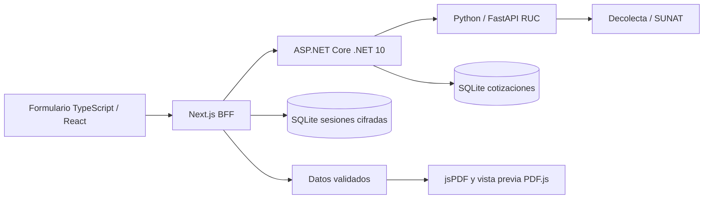

# Arquitectura implementada

Next.js mantiene sesión OIDC, valida entradas y actúa como BFF. ASP.NET Core valida nuevamente, recalcula importes en centavos y guarda versiones inmutables separadas por propietario. Python encapsula la consulta de identidad externa con tiempo límite, caché acotada y una clave interna entre servicios. Decolecta se invoca por HTTPS con Bearer; el secreto queda en Python.

El PDF se genera en el navegador con fuentes locales a partir de datos validados por el servidor. Esto permite imprimir o descargar sin subir documentos a terceros. La vista previa dibuja el mismo PDF y no simula la página con otro diseño HTML. El resumen en vivo del formulario es orientativo.

El cliente selecciona DNI o RUC; Empresa exige RUC. Un RUC requiere once dígitos, prefijo admitido, verificador correcto y coincidencia del nombre devuelto por el proveedor. El nombre está bloqueado para edición durante ese flujo. El servidor descarta procedencia suministrada por el navegador y la sustituye por la consulta autoritativa; una consulta sin resultado impide crear la cotización RUC.

Se conservan los backends alternativos TypeScript y Python del paquete para compatibilidad y se prueban mediante HTTP. El arranque integrado y Compose usan .NET como único repositorio de cotizaciones. No hay sincronización entre bases alternativas.

Los tres dominios aplican validaciones equivalentes y el contrato JSON exportado desde TypeScript. Las versiones históricas se conservan para lectura; los endpoints de creación exigen ambas versiones en 2 para impedir eludir reglas actuales. Los cálculos usan centavos enteros.

El lanzador de Visual Studio coordina servicios y detecta puertos ocupados. El emisor local OIDC solo atiende 127.0.0.1, limita códigos, caduca en dos minutos y comprueba cliente, callback y PKCE. Es una facilidad de desarrollo con una cuenta compartida, no un sistema de usuarios comerciales.

## Catálogo comercial

El módulo público usa el BFF Next.js y una instantánea validada en SQLite de .NET. Python añade validación e importación del contrato; los modos alternativos Next.js/Python conservan compatibilidad HTTP. Ver `CATALOGO.md` para flujo, límites y migración aditiva. El catálogo no escribe cotizaciones.
